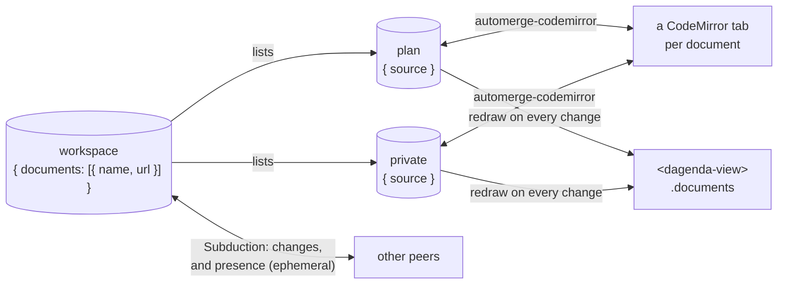

# `@inkandswitch/dagenda-editor`

> [!NOTE]
> Early, on alpha dependencies. Text and picture edits sync between browsers through Subduction, with presence, per-person undo, and offline use.

A collaborative editor for dagenda plans. A plan is several documents (public, private, and later one per commenter), so the editor opens a _workspace_: an Automerge document listing them. Each has a tab, its text in CodeMirror, and one tech tree is drawn from all of them. The preview is the same editor on one document kept in the browser: the two pages differ only in their _store_, where the documents live.

To run it locally:

```console
$ nix run .#collab        # from the repo root: http://localhost:8080/collab/ (PORT=… to change)
$ nix run .#preview       # the same server and port; the preview is at /preview/
```

It installs the JS dependencies if needed, builds the component's Wasm, and starts Vite, which rebuilds the Wasm when the Rust changes ([`vite.config.js`](vite.config.js)). Open the page, then open its URL (with the `#automerge:…` it adds) in another browser. `?sync=wss://…` picks a different Subduction server. `#source=…` (URL-encoded text) starts a new workspace with that text, which is how the preview's _Collaborate_ button hands its plan over.

## What it does

- **Edit the picture.** Click a card's badge to set its status, drag from a badge onto a card to add a need, drag a card into another milestone's band to re-scope it, or drag a milestone's dashed line (or its gate) to move its boundary over cards, or past another milestone's to reorder them. Each lands in the text of the document it belongs to, as the smallest splice, so it joins your undo and merges with what anyone types meanwhile.
- **Move around the picture** as in the preview: drag or scroll to pan, Ctrl/⌘ + wheel or a pinch to zoom. See [Moving Around](../../README.md#moving-around) for mouse, trackpad, and touch.
- **A tab per document.** _+_ adds a document to the plan (a private one, say); double-click a tab to rename it. Everyone sees the same tabs.
- **One picture from every document.** A private document can `extend` a public task, or `needs` one, and the tree shows it all. Problems say which document they're in (`private:3:7`); clicking one, or a card, opens that document at that line.
- **Text that doesn't parse** (someone mid-edit) keeps the last good picture up on every replica, with the error in the status line, its line marked, and its tab outlined.
- **Presence.** Each person has a name like `silly-teal-otter`, listed in the header with the tab they're on, and a caret and selection in that colour in each document. Click your own name to change it.
- **Undo is per person.** Undo covers your own typing and the examples you load, never someone else's edits.
- **Sync status.** _synced_ once the server holds everything this tab has, for the workspace and every document in it; _syncing…_ on the way; _not synced_ offline, with where the changes are kept.
- **Offline.** One tab per browser keeps documents in IndexedDB, under the browser's own identity. Other tabs sync live, in memory. A document not on the server yet is looked for until it turns up.

## Two pages, one editor

```
            mountEditor({ prefix, store, help })      src/editor.js
           ┌──────────────────────────────────────┐
           │ a CodeMirror tab per document, indent,│
           │ undo, picture edits as splices, go to │
           │ a line, the page shell (shell.js)     │
           └───────────────────┬──────────────────┘
                               │ store: list, watch, open, [rename, create, presence]
              ┌────────────────┴────────────────┐
     src/preview.js                      src/collab.js
     one document, in localStorage       an Automerge workspace, synced, with presence
```

Both pages share their panes and header ([`src/panes.html`](src/panes.html), [`src/header-end.html`](src/header-end.html)), the page shell, styles, examples, and syntax colouring. A store without `create` or `rename` has no _+_ and no renaming.

## How it fits together



- **Documents are text.** The picture is always derived from the documents' `source`. A concurrent edit can't corrupt a structure: at worst, the merged text doesn't parse, and the picture keeps its last good state.
- **One document per unit of access.** Until Keyhive, a private document is one whose URL isn't linked from anything public. The workspace links them all, so it's the team's, not the public's.
- **Undo is CodeMirror's history, kept to this person.** Remote changes arrive without a user event and stay out of it.

## The stack (all pinned: these are alphas)

| Package | Version | Role |
|---|---|---|
| `@automerge/automerge-repo` | 3.0.0-alpha.2 | Documents, handles (`create`/`find` are async in v3), and `Presence` |
| `@automerge/automerge-repo-subduction` | 3.0.0-alpha.2 | The `SubductionBackend` passed to `new Repo({ backend })` |
| `…-subduction-network-websocket` | 3.0.0-alpha.2 | Connection to the sync server (default `wss://subduction.sync.inkandswitch.com`) |
| `…-subduction-storage-indexeddb` | 3.0.0-alpha.2 | Local storage, so documents work offline |
| `@automerge/subduction` | 0.27.0 | `createWebCryptoSigner()`: a stable peer identity per browser |
| `@automerge/automerge` | 3.5.0 | Importing it initializes the Wasm the `slim` imports share; cursors for presence |
| `@automerge/automerge-codemirror` | 0.2.0 | Keeps a CodeMirror view and a document's `source` in step |

## Tests

```console
$ nix run .#ci-editor     # builds both pages, then drives them in headless Chromium
```

The browser tests ([`browser-test/`](browser-test/)) talk to Chromium over the DevTools protocol, with no dependencies. Sync goes through the public Subduction server unless `DAGENDA_SYNC` names another.
